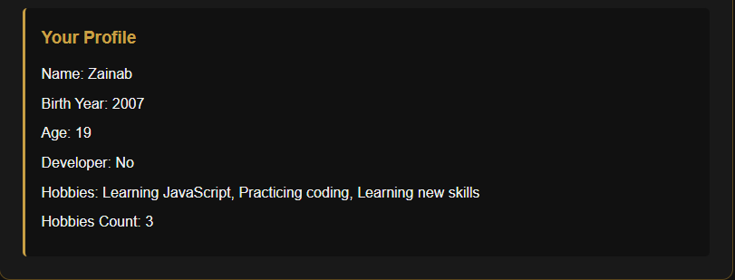
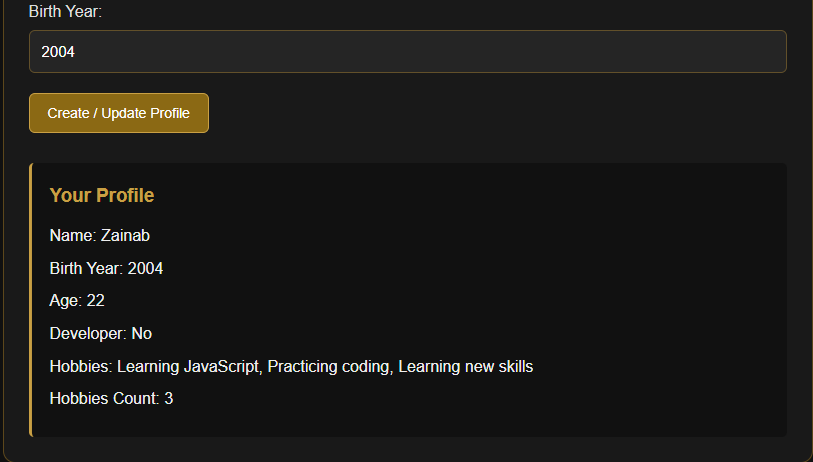
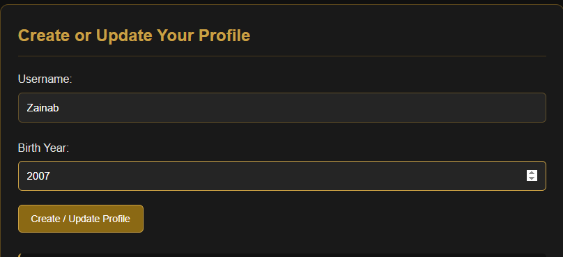
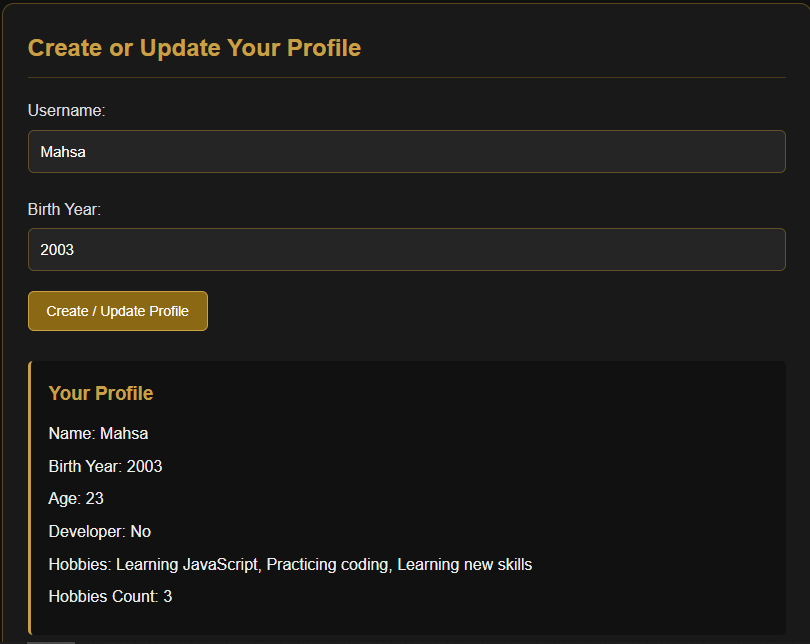
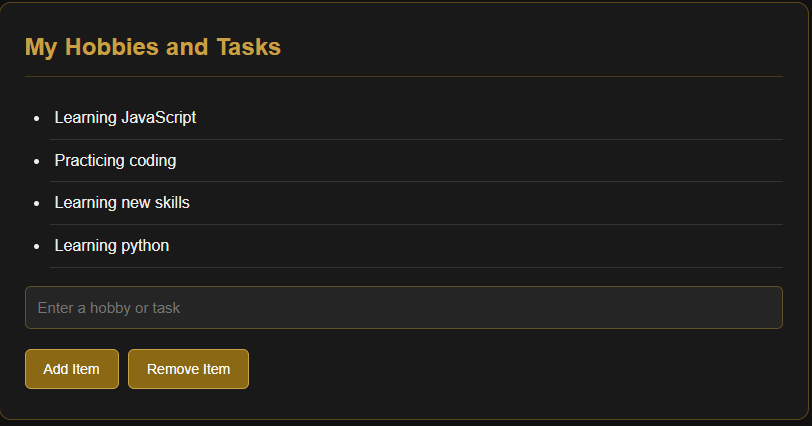

 Assignment 5: JavaScript Basics

Name: Zainab  
Group: 2501  
University: Astana IT University

 Task 1: Personal Info Object
Created a JavaScript object named userProfile containing a string, number, boolean, and array.

 Task 2: Arithmetic Calculations
Calculated the user's age using the current year and birth year. Displayed the number of hobbies.

 Task 3: HTML Form Setup
Created username and birth year input fields with a Create / Update Profile button.

 Task 4: Event Listener
Used a submit event listener to read the form values and update the profile.

 Task 5: Creating and Removing Elements
Created an unordered list with buttons to add a new item and remove the last item.

 Summary
I created a personal profile webpage using HTML, CSS, and JavaScript. I practiced JavaScript objects, data types, arithmetic operations, event listeners, and DOM manipulation. I also designed the webpage with a black-and-gold color theme and tested the form and list buttons.
